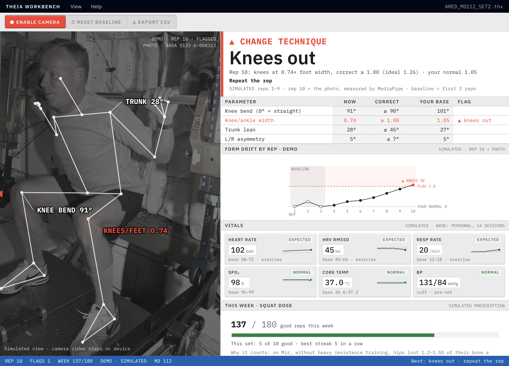

<p align="center"></p>

<h1 align="center">Theia</h1>

<p align="center"><b>Stay strong, stay safe: a camera coach against injury and bone loss. On Earth and in space.</b></p>

<p align="center">
  <a href="https://theia-app.pages.dev">Live demo</a> ·
  <a href="https://theia-app.pages.dev/space">Space</a> ·
  <a href="https://theia-app.pages.dev/earth">Earth</a>
</p>

Our project for the **NASA Space Apps Challenge 2026** (Vienna), challenge **"Health Monitoring Software for Astronauts"**.



## What it does

Astronauts lose 1–1.5% of their hip bone a month without heavy resistance exercise. On Earth, similar loss hits people after a leg injury or amputation. 

Exercise only protects bone, muscle and joints when it's done often and done correctly, and usually nobody is there to watch.

**Theia watches every rep through a camera and tells you what to fix:**

- **Space** (`/space`, tablet).
- **Earth** (`/earth`, phone).

## Run it

You need [Node.js](https://nodejs.org) 24 or newer.

```sh
git clone https://github.com/aodanchenko/theia-app.git
cd theia-app
npm install
npm run dev
```

## Team

[Anna Danchenko](https://www.linkedin.com/in/anna-danchenko/) · [Mariia Shevtsova](https://www.linkedin.com/in/mariia-shevtsova-0751a2193/) · [Oleksandr Namchuk](https://www.linkedin.com/in/oleksandr-namchuk-249488236/) · [Hlib Plakhtii](https://www.linkedin.com/in/hlib-plakhtii/)

## License

Our own code and content: [Apache License 2.0](LICENSE), the licence NASA applies to Space Apps solutions by default. Third-party parts keep their own licences (above).
